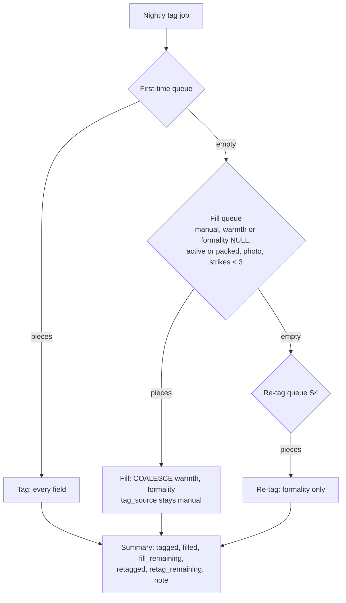

# Closet picker: the tagger fills blanks on hand-saved pieces (#549)

Story S5 of epic #539. Parent plan: `2026-11-20-closet-picker-week-design.md`.
Builds on S4 (#548, `2026-11-24-closet-formality-scale-design.md`), which added
the re-tag queue this extends. The repo is public: no garment names here, in
tests or in issues.

## Problem

A hand save sets `tag_source = manual` and takes the piece out of the tag queue
for good (`backend/closet_routes.py`), even when the owner set one field and left
warmth or formality empty. Since #545 such a piece counts as needing details and
loses to any tagged piece in the picker, so a half-saved piece is close to
invisible until the owner finishes it by hand.

## Scope

In: a third tag-queue mode that fills warmth and formality on `manual` pieces
where either is empty, never touching a set field; a separate count on the Jobs
page's tag row.

Out: seasons (empty means all year, `closet.is_tagged`), any other field (names,
colours, pattern: not what the picker needs), re-tagging model pieces (S4), the
graphic flag (S6), UI changes.

## Solution

1. **Mode, not flag.** `tag_batch` and `_run` take a mode, `"new" | "fill" |
   "retag"`, replacing S4's `retag: bool`. `_run` takes new first, then fill, then
   re-tag (blanks are worse than an old scale). Batches stay one mode. Tag now
   keeps to `"new"`.
2. **The fill queue** (`_to_fill()`): `tag_source = manual`, `warmth IS NULL OR
   formality IS NULL`, status `active` or `packed`, `tag_attempts <
   MAX_ATTEMPTS`, with a photo, oldest first.
3. **A fill reads only warmth and formality** from the answer (as S4's re-tag
   reads only formality; a bad category does not reject it). The write is
   `warmth = COALESCE(warmth, :new)`, `formality = COALESCE(formality, :new)`,
   guarded by `tag_source = manual AND (warmth IS NULL OR formality IS NULL)`,
   so a field the owner sets during the call wins, and `tag_source`, status,
   colours and `updated_at` never move. `tag_scale` becomes current when the
   fill wrote the formality.
4. **Strikes.** A fill that leaves the piece still blank (the model gave no usable
   value for a missing field) strikes it, so an unreadable photo leaves the queue
   after three. A rejected multi-photo batch retries one at a time as now.
5. **Jobs row.** The job summary gains `filled` and `fill_remaining`. The note
   joins the parts that apply, for example "Blanks filled: 3, 2 left · Formality
   re-tag: 10 done tonight, 30 left", only when the run made calls and there is
   no error note (S4's rule).

## Decisions and tradeoffs

- **Warmth and formality only** (my call). They are what `is_tagged` and the
  picker need; empty seasons means all year, so filling it would overrule a hand
  save that left it empty on purpose.
- **No migration.** The queue is derived from the empty columns; a filled piece
  leaves it by being filled, an unreadable one by strikes.
- **Prior strikes count**, as in S4: a piece that struck out as untagged before
  the owner saved it by hand stays out. Resetting would rewrite data.
- **Fill before re-tag**: a blank keeps a piece out of the picker; an old scale
  does not.

## Sources

- `backend/closet_routes.py` (`_queued`, `_requeued`, `tag_batch`, `_run`,
  `tag_job`), `backend/closet_tag.py` (`validate(retag=...)`),
  `backend/closet.py` (`is_tagged`), `backend/closet_schemas.py` (`TagJobOut`).
- Issue #549; S4's plan.

## Smoke check

None: no public route, title or header changes.

## Plan

Model: Sonnet for both tasks.

### Task 1: the fill mode
- Files: `backend/closet_routes.py`, `backend/closet_tag.py`,
  `backend/closet_schemas.py`, `backend/tests/test_closet_tag.py`,
  `backend/tests/test_closet_response_models.py`, `backend/CLAUDE.md`.
- Mode refactor (behaviour of new and re-tag unchanged; their tests stay green
  untouched where possible). `validate` gets a mode that reads only
  warmth and formality for a fill.
- Tests (acceptance of #549): a partial manual piece gets its blanks filled and
  keeps its set fields and `tag_source = manual`; a fully set manual piece is
  never sent; a field set by hand during the call wins; still-blank after a fill
  strikes, three strikes leave it out; listed, gone and photo-less are skipped;
  order is new, fill, re-tag; Tag now never fills; the summary carries `filled`,
  `fill_remaining` and the joined note; budget 0 leaves no note.
- Docstrings: `closet_routes.py` module docstring ("A hand save is final" now
  says final for every field it set) and `backend/CLAUDE.md`'s Closet line.

### Task 2: changelog
- `frontend/changelog.md`: a "Behind the scenes" bullet at the top of the
  existing `## 2026-11-24` heading (the local date; a new heading would move
  Home's visual baselines, `docs/learnings.md` 2026-11-24).
- Also flip `docs/planning/2026-11-24-closet-formality-scale-design.md` to
  `status: done` (S4 shipped in #654).

### Ship notes
No migration. After deploy the nightly job fills blanks before re-tagging, within
the same budget.
