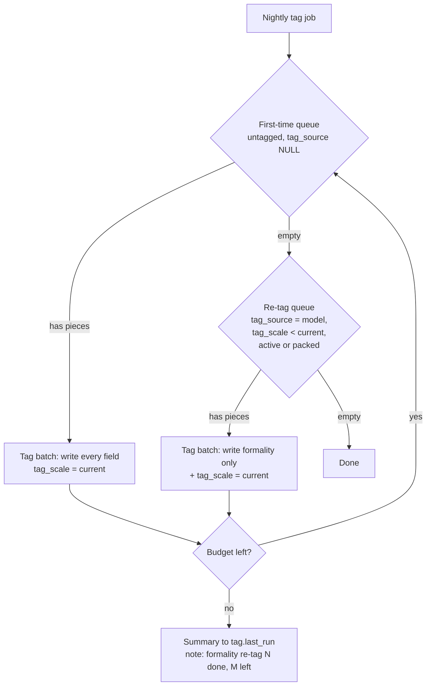

# Closet picker: a formality scale with anchors, office 2 to 4, and a re-tag (#548)

Story S4 of epic #539. Parent plan: `2026-11-20-closet-picker-week-design.md`.
Brief: `2026-11-20-closet-picker-week-brief.md`. The repo is public: no garment
names here, in tests or in issues.

## Problem

The tagging prompt defines formality only as "1 (lounge) to 5 (business)"
(`INSTRUCTIONS`, `backend/closet_tag.py:114`). With no anchors the model put most
tops at 2, including flannels and casual button-ups. Office requires 3 to 5
(`OCCASION_FORMALITY`, `backend/closet.py:72`), so those tops failed office even
though, as decided on 2026-11-20, they are fine at the owner's office. S3's
relaxation (#547) hides the symptom by loosening formality when a slot starves,
but the page then reports a relaxation that the data caused, not the day.

## Scope

In:
- Formality anchors in the tagging prompt.
- Office becomes 2 to 4 (target 3). Other occasions unchanged.
- A re-tag of formality on model-tagged pieces, through the existing queue,
  budget and nightly job.
- The tag row on the Jobs page says how far the re-tag has got.

Out: filling blanks on hand-saved pieces (S5, #549), the graphic flag (S6, #550),
re-tagging warmth, seasons, names or categories, any new UI.

## Solution

1. **Anchors** (`closet_tag.INSTRUCTIONS`). Formality, with anchors:
   1 lounge or gym (sweatpants, a graphic tee); 2 casual (a plain tee, a hoodie,
   sneakers); 3 smart casual (a flannel or casual button-up, a polo, chinos,
   dark jeans); 4 business casual (an oxford or dress shirt, wool trousers,
   loafers, leather dress shoes); 5 business formal (a suit, a tie, a
   tuxedo). A flannel or casual
   button-up can be 2 or 3 depending on how it reads. This matches the issue's
   anchors (graphic tee 1, flannel 2 to 3, oxford 3 to 4).
2. **Office 2 to 4** (`OCCASION_FORMALITY["office"] = (2, 4, 3)`). The target
   stays 3, so a flannel at 2 still ranks below a 3 when both fit. The ceiling
   drops from 5 to 4: a suit is not an office pick, though "event" (3 to 5) keeps it.
3. **A scale version per garment.** New column `garments.tag_scale smallint NOT
   NULL DEFAULT 1` (migration 0031, additive). `closet_tag.SCALE_VERSION = 2`.
   Every tag write sets `tag_scale = SCALE_VERSION`. Raising the constant
   queues every model-tagged piece below it for a re-tag, and the deploy does
   this without anyone running a script.
4. **The re-tag queue**: `tag_source = model`, `tag_scale < SCALE_VERSION`,
   status `active` or `packed` (not `listed` or `gone`, which would waste the
   budget), fewer than `MAX_ATTEMPTS` strikes, with a photo, oldest first. It is
   taken only when the first-time queue is empty, so new photos are never held up. Only the nightly job takes it: Tag now
   (the page's button) stays on the first-time queue and spends no call on a re-tag.
5. **A re-tag writes formality and `tag_scale` only.** It uses the same call and
   prompt and ignores every other field in the answer. The `UPDATE` is guarded by
   `tag_source = model AND tag_scale < SCALE_VERSION`, so a hand save landing during
   the call (which sets `manual`) wins, as it does for first-time tags. Colours,
   names, brands, `color_source` and status are never in the statement.
6. **Strikes.** `_strike` also counts against a re-tag piece (guarded by
   `tag_source = model`). A piece that runs out of attempts keeps its old
   formality.
7. **The Jobs row.** `tag.last_run` gains `retagged` (this run) and
   `retag_remaining`. When either is non-zero and the run has no error note, the
   note reads "Formality re-tag: N done tonight, M left", and the existing
   `runRow` shows it (`frontend/src/lib/nightly.js:244`). No frontend change.
   `remaining` keeps its meaning (new photos waiting), so the Closet page's count
   is unchanged.

## Decisions and tradeoffs

- **A column, not a reset (architecture decision).** Alternatives:
  (a) set re-tag pieces back to `untagged`/`tag_source NULL`. That rewrites
  existing data (an always-stop) and takes the pieces out of Today until they
  are re-tagged, which at 5 calls a night could be several nights for the whole
  closet. (b) a `closet_settings` marker compared with `updated_at`. That breaks
  as soon as a photo replacement moves `updated_at`. (c) the column: one additive
  migration, no data rewritten, and the next scale change is a one-line bump.
  Chose (c).
- **Formality only** (my call). Only the formality scale changed. Re-writing
  names, categories, warmth or seasons would churn what the owner already sees
  for no reason, and a category flip would move a piece between slots. Cost: a
  bad warmth or season guess stays (S2 made season a score; S5 and the owner's
  edits cover the rest).
- **Prior strikes count** (my call). Resetting `tag_attempts` would rewrite data.
  A model-tagged piece that needed two tries the first time gets one re-tag try.
  Few pieces are like that, and the Jobs row shows what is left.
- **`listed`/`gone` skipped.** They are never planned.
- **Office ceiling 4.** Not asked for in the issue, but the range is 2 to 4 as the
  issue says. Event and date are unchanged. Dress shoes sit at 4, not 5, so
  the ceiling of 4 does not shut out every pair of work shoes; 5 is formal wear.

## Sources

- `backend/closet_tag.py` (`INSTRUCTIONS`, `COLOUR_FIELDS`, `MAX_ATTEMPTS`)
- `backend/closet_routes.py` (`_queued`, `_strike`, `tag_batch`, `_run`,
  `tag_now`, `tag_job`, `DEFAULT_TAG_BUDGET = 5`)
- `backend/closet.py` (`OCCASION_FORMALITY`, `fits_occasion`)
- `backend/models.py` (`GarmentStatus`, `GarmentTagSource`, `GarmentColorSource`)
- `frontend/src/lib/nightly.js` (`runRow`, the `closet-tags` row)
- Issue #548; parent plan's "Re-tagging" answer.

## Open questions

None blocking.

## Smoke check

None changes: no public route, title or header moves. After deploy, the Jobs
page's Closet tags row shows the re-tag note on the first nightly run.

## Plan

Tasks run in order on one branch (they share `closet_routes.py`). Sonnet.

### Task 1: anchors and office range
- Files: `backend/closet_tag.py`, `backend/closet.py`,
  `backend/tests/test_closet_tag.py`, `backend/tests/test_closet.py`.
- `INSTRUCTIONS` gets the anchors above. `OCCASION_FORMALITY["office"] = (2, 4, 3)`;
  update the comment and the module docstring if they quote the range.
- Tests: the prompt names each anchor level (1 to 5); `fits_occasion` office
  accepts 2 and 4, rejects 1 and 5; existing office tests updated where they
  assumed 3 to 5 (`test_closet.py:164-165`, `:603-604`, and any in
  `test_closet_today.py`).
- Acceptance: `pytest tests/test_closet.py tests/test_closet_tag.py` green.

### Task 2: migration 0031 `garments.tag_scale`
- Files: `backend/migrations/versions/0031_garment_tag_scale.py`,
  `backend/models.py` (`Garment.tag_scale`), `closet_tag.SCALE_VERSION = 2`.
- Additive: `smallint NOT NULL server_default 1`; downgrade drops it.
- Tests: `tests/test_migrations.py` cycle passes.

### Task 3: the re-tag queue and write
- Files: `backend/closet_routes.py`, `backend/closet_schemas.py`
  (`TagJobOut`, `TagNowOut` add `retag_remaining`, `TagJobOut` adds `retagged`),
  `backend/tests/test_closet_tag_routes.py` (or wherever the tag queue is tested now).
- First-time write sets `tag_scale = SCALE_VERSION`. `_requeued()` query; `tag_batch`
  takes a `retag` mode chosen by `_run` when the first-time queue is empty;
  re-tag `UPDATE` writes `formality` and `tag_scale` only, guarded as above;
  `_strike` covers both modes. Module docstring updated.
- Tests (acceptance criteria of #548):
  - a model-tagged piece at scale 1 is re-tagged: formality changes, name,
    category, colours, warmth, seasons and status do not; `tag_scale` becomes 2;
  - a `manual` piece is never sent and never written;
  - a model-tagged piece with `color_source = vendor` keeps its colours and name;
  - a hand save during the call wins (the guarded update writes nothing);
  - first-time pieces go before re-tags; `listed`/`gone` are skipped;
  - a single-photo re-tag failure strikes; three strikes leave it out;
  - the job summary carries `retagged`, `retag_remaining` and the note.
- Acceptance: targeted backend tests green.

### Task 4: changelog, docs
- `frontend/changelog.md`: a "Behind the scenes" bullet under today's heading:
  the outfit planner's formality scale has examples, flannels and casual
  button-ups count for the office, and existing pieces are re-tagged overnight.
- `backend/CLAUDE.md` Closet section: one line on `tag_scale` and how to start a
  re-tag (raise `SCALE_VERSION`).
- Mark this doc `status: done` at ship.

### Ship notes
- Migration 0031: **additive** (a new column with a default). Applied by the
  Deploy API workflow on merge; `neon-rehearsal` runs on the PR.
- After deploy the nightly tag job re-tags about 50 pieces a night at the default
  budget of 5 calls. Nothing is applied by hand.
