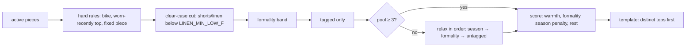

# Closet picker: a pool that cannot starve (#545, #546, #547)

Stories S1 to S3 of epic #539. Parent plan:
`2026-11-20-closet-picker-week-design.md`. Brief:
`2026-11-20-closet-picker-week-brief.md`. The repo is public: no garment names
here, in tests or in issues.

## Problem

On 2026-11-20, one of 19 tops passed the filter for a cold office day, and it was
the untagged one. Three rules combined: a missing warmth or formality passes every
rule, season is a hard cut on months the tagger guessed, and nothing checks how
many candidates a slot has. `template` then reused that top for all three outfits.

## Scope

In:
- **S1 #545.** A piece missing warmth or formality is left out of a slot while the
  slot has a tagged candidate. It comes back only when none is left, and the plan
  says so. The Closet page counts the pieces that need details and links to them.
- **S2 #546.** Season becomes a score penalty. A hard cut stays only for clear
  cases: shorts and linen when the day's low is below a threshold.
- **S3 #547.** A minimum pool of three per slot, reached by visible relaxation.
  The plan records per slot what was relaxed, and Today says it in words. The lead
  and the alternatives use different tops whenever the pool allows.

Out: the funnel display (#553), feedback (#551), the formality anchors and re-tag
(#548), filling blanks on hand-saved pieces (#549), the graphic flag (#550).

## Solution

- **One predicate, two callers.** `candidates()` and `slot_fallback()` repeat the
  same filter today (`closet.py:370-375`, `416-419`). S1 extracts a single
  `eligible(piece, request, read, relaxed)` that both call, so the Swap sheet
  (`GET /api/closet/candidates`) cannot drift from the plan.
- **"Tagged"** means `warmth is not None and formality is not None`
  (`closet.is_tagged`). An empty `seasons` already means all year, so it is not
  "missing".
- **Relaxation record.** `Candidates` gains `relaxed: dict[slot, tuple[str, ...]]`
  holding the steps in the order applied: `"season"`, `"formality"`, `"untagged"`.
  `make_plan` stores it in the plan body as `relaxed` (an object keyed by slot,
  omitted slots meaning nothing was relaxed). Older stored plans have no key and
  read as nothing relaxed.
- **S1 alone** has one relaxation: `"untagged"`, used when a slot has no tagged
  candidate.
- **S2** removes `in_season` from the filter. `score()` adds
  `WEIGHTS["season"] * 1` when the month is not in a non-empty `seasons`. The clear-case cut
  `clearly_out_of_season(piece, read)` is true when `read.low < LINEN_MIN_LOW_F`
  (50 °F) and the piece's name, subtype or material contains `shorts` or `linen`
  (word match, the same `_words` helper the bike rule uses). Constants are tested.
- **S3** sets `MIN_POOL = 3`. For a slot with fewer than three: lift the clear-case
  cut (`season`), then widen the occasion's formality band by one each side
  (`formality`), then allow untagged pieces (`untagged`), stopping as soon as the
  slot reaches three. The bike rule, the worn-recently rule and the fixed piece are
  never relaxed. `template()` assigns tops first: outfit *k* takes the *k*-th top
  when one exists, before it considers bottoms and shoes. `closet_rank.validate`
  drops a model outfit whose top repeats an earlier outfit's top while the top pool
  has at least `OUTFITS` pieces, and `top_up` refills from the template. When the
  pool is smaller, the body carries `shared_top: true`.
- **Today** renders one line per relaxed slot under the outfit board, from
  `adminCopy.closetToday` (for example "Few tops fit, so formality was widened."), and,
  when `shared_top` is set, "Only N tops fit today, so the outfits share one."

## Decisions and tradeoffs (my call, auto mode)

- **Order of relaxation: season, formality, untagged.** The story names season,
  then formality. Untagged goes last because S1 makes "no tagged candidate" the
  only reason to use one, and in S3 that becomes "still under three after the
  other two".
- **"Relax season" after S2 means lifting the clear-case cut**, since season is no
  longer a filter. Shorts on a cold day can therefore appear only in a slot with
  fewer than three other choices, and the page says so.
- **Formality widens by one step each side**, not all the way: office becomes 2 to 5 rather
  than 1 to 5.
- **50 °F for the shorts and linen cut**, the low below which the warmth table
  already wants warmth 4 (`warmth_for`: 40 to 54 → 4).
- **Distinct tops enforced in code, not only asked of the model.** The model can
  only choose from the shortlist, and on 2026-11-20 it reused the tee; the
  validator is the reliable place.
- **Stored plans are not re-checked.** A rule change reaches the day the next time
  that day is planned: the nightly job or a re-plan. No backfill.
- **The needs-details count is client-side** from the garment list the Closet page
  already loads (`warmth`, `formality` are in `GarmentOut`), with a new filter chip
  `needsDetails`. No new endpoint.
- **No mockups.** The UI is one line of text on each of two existing pages, in their current
  styles. The funnel (#553) is the story that gets the design step.

## Sources

- `backend/closet.py` (`candidates`, `slot_fallback`, `in_season`, `fits_occasion`,
  `score`, `template`, `OCCASION_FORMALITY`, `warmth_for`, `_words`).
- `backend/closet_rank.py` (`validate`, `top_up`, `outcome`).
- `backend/closet_today_routes.py` (`make_plan` body, `GET /api/closet/candidates`).
- `frontend/src/pages/AdminClosetToday.jsx`, `AdminCloset.jsx`, `lib/closet.js`
  (`filterGarments`, `DEFAULT_FILTER`, `footnoteLine`), `content/adminCopy.js`.
- `docs/learnings.md` 2026-11-18: test filters against the real long tail. The
  tests replay the 2026-11-20 shape (19 tops, 13 tagged summer-only and formality 2,
  one untagged) with synthetic names.

## Open questions

None blocking. Whether 50 °F is the right cut is a judgement; it is one constant.

## Smoke check

No public output changes (the closet is admin-only), and `smoke.sh` pins nothing here.
After each deploy: `/api/version` reports the SHA (the Deploy API workflow does
this), and `./scripts/render-logs.sh 30 error` is empty.

## Plan

One PR per story, in order, each squash-merged when its checks are green before
the next branch is cut from `main`.

### Task 1 (PR 1, #545): untagged is not a pass

Files: `backend/closet.py`, `backend/closet_today_routes.py`,
`backend/tests/test_closet.py`, `backend/tests/test_closet_today.py`,
`frontend/src/lib/closet.js` (+ test), `frontend/src/pages/AdminCloset.jsx`
(+ test), `frontend/src/pages/AdminClosetToday.jsx` (+ test),
`frontend/src/content/adminCopy.js`, `frontend/changelog.md`.

Acceptance:
- `is_tagged` and a shared `eligible` used by `candidates` and `slot_fallback`.
- A slot with tagged and untagged candidates excludes the untagged; a slot with
  only untagged ones still fills, and `relaxed[slot] == ("untagged",)`.
- The plan body carries `relaxed`; Today shows one line per relaxed slot.
- The Closet page shows "N pieces need details" when N > 0, as a button that sets
  the `needsDetails` filter (active pieces missing warmth or formality).
- `/candidates` follows the same rule (test).

### Task 2 (PR 2, #546): season becomes a score

Files: `backend/closet.py`, `backend/tests/test_closet.py`,
`backend/tests/test_closet_rank.py` if a fixture depended on the cut,
`frontend/changelog.md`.

Acceptance:
- `in_season` no longer excludes; `score` adds the season penalty (test: same piece,
  in and out of season, scores differ by the weight).
- `clearly_out_of_season` with `LINEN_MIN_LOW_F = 50`, tested at 49 and 50, for
  shorts, linen material and linen in the name, in top and bottom.
- A replay of the 2026-11-20 shape: a 37 to 61 °F office day leaves several tops
  eligible, ordered by warmth fit.

### Task 3 (PR 3, #547): minimum pool and distinct tops

Files: `backend/closet.py`, `backend/closet_rank.py`,
`backend/closet_today_routes.py`, backend tests, `AdminClosetToday.jsx` (+ test),
`adminCopy.js`, `frontend/changelog.md`.

Acceptance:
- `MIN_POOL = 3`; relaxation in order with each step tested, plus the
  one-candidate pool (records all three steps; outfits share the top;
  `shared_top: true`).
- `template` gives distinct tops when there are at least three; `validate` drops a
  model outfit with a repeated top when the pool allows, and `top_up` refills.
- `GET /api/closet/candidates?slot=top&occasion=office` returns three or more
  when three exist after relaxation.
- Today renders the relaxation lines and the shared-top line.

Every task: the frontend CI steps run locally before the push (`npm run lint`,
`npm run format:check`, `npm test`, `VITE_DAILY_SALT=local npm run build`), and
`ruff` and targeted `pytest` run for the backend. Then grep the tests for pinned route
counts.

### Ship notes

No migration. `outfit_plans.body` is JSONB and gains optional keys. The API deploys
through the Deploy API workflow on each merge.
